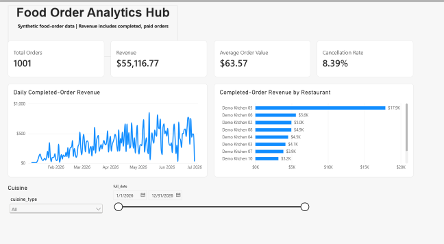

# FoodOrder Analytics Hub

A local data engineering and analytics project built with Python,
MySQL, SQL, and Power BI.

The project generates synthetic food-order data, loads a source
database, transforms records into a dimensional warehouse, and
provides an interactive report. It supports full refreshes,
watermark-based incremental order loading, validation, and
pipeline execution logging.

## Report Preview



See the [Power BI report guide](docs/powerbi-report.md) for
metric definitions, verified results, and refresh instructions.

## Project Status

The local implementation is complete and has been tested in the
development environment. A fresh installation using the documented
setup instructions has not yet been independently verified.

Implemented and tested:

- Reproducible synthetic data generation
- MySQL source database and CSV loading
- Dimensional analytics warehouse
- Transactional full refresh
- Watermark-based incremental order loading
- Insert, update, and repeat-run checks
- Source-to-warehouse reconciliation
- Reporting views and aggregate reconciliation
- Pipeline execution logging
- Controlled failure logging and successful recovery
- Power BI Overview and Validation pages
- Cuisine and date filtering

Microsoft Fabric migration is outside the current scope.

## Architecture

```mermaid
flowchart TD
    A["Python data generator"] --> B["Synthetic CSV files"]
    B --> C["MySQL source database"]
    C --> D["SQL transformations"]
    D --> E["MySQL analytics warehouse"]
    E --> F["Power BI report"]
    G["Python pipeline runner"] --> D
    G --> H["Execution logs"]
    D --> I["Incremental watermark"]
```



The source and analytics databases run on the local MySQL Server.
Power BI imports the warehouse tables.

## Technology Stack

| Component | Technology |
|---|---|
| Data generation and pipeline execution | Python 3.13 |
| Synthetic names | Faker |
| Database connectivity | MySQL Connector/Python |
| Source and warehouse storage | MySQL Server 8.0 |
| Database development | MySQL Workbench |
| Reporting | Power BI Desktop |
| Power BI database driver | MySQL Connector/NET |
| Version control | Git and GitHub |

Exact Python package versions are listed in
[requirements.txt](requirements.txt).

## Dataset

All records are synthetic. They do not represent real customers,
restaurants, or business performance.

The base generator creates:

- 100 customers
- 10 restaurants
- 1,000 orders
- Order activity from January through June 2026

The incremental test scripts add order `1001` on July 1, 2026,
with an amount of `25.00`, then update its amount to `35.00`.

After these tests, the source and warehouse contain 1,001 orders.

The generator uses fixed random seeds and fixed date boundaries.
Use the recorded dependency versions to reproduce the dataset.

## Data Model

### Source Database: `foodorder_source`

| Table | Grain |
|---|---|
| `customers` | One row per customer |
| `restaurants` | One row per restaurant |
| `orders` | One row per order |

### Analytics Database: `foodorder_analytics`

| Table | Purpose |
|---|---|
| `dim_customers` | Customer attributes and warehouse keys |
| `dim_restaurants` | Restaurant attributes and warehouse keys |
| `dim_date` | Calendar attributes for all 365 dates in 2026 |
| `fact_orders` | One row per order |
| `pipeline_run_log` | Execution status, timestamps, counts, and errors |
| `pipeline_watermarks` | Last successfully processed source timestamp |

Customer and restaurant dimensions currently contain one current
row per source ID. Historical dimension versions are not implemented.

Source IDs are mapped to warehouse surrogate keys when facts
are loaded.

### Reporting Views

| View | Purpose |
|---|---|
| `vw_order_overview` | Overall order and revenue metrics |
| `vw_restaurant_performance` | Metrics grouped by restaurant |
| `vw_daily_performance` | Metrics grouped by calendar date |

The Power BI report uses the dimension and fact tables directly
so filters work across the star schema.

## Business Definitions

| Metric | Definition |
|---|---|
| Total Orders | All orders, including completed, cancelled, and pending |
| Completed Paid Orders | Orders with `Completed` status and `Paid` payment status |
| Revenue | Sum of amounts for completed, paid orders |
| Average Order Value | Revenue divided by completed, paid orders |
| Cancelled Orders | Orders with `Cancelled` status |
| Cancellation Rate | Cancelled orders divided by total orders |

Revenue represents qualifying order value, not platform profit.

Amounts are displayed as USD for demonstration purposes.

## Loading Strategies

### Initial CSV Load

[src/load_mysql.py](src/load_mysql.py):

- Reads the generated CSV files
- Validates their column names
- Requires empty source tables
- Loads customers and restaurants before orders
- Uses parameterized batch inserts
- Checks loaded row counts
- Commits all inserts together or rolls back on failure

### Full Refresh

The `refresh_analytics` procedure:

- Rebuilds dimensions and order facts in a transaction
- Loads the full 2026 calendar
- Maps source IDs to warehouse keys
- Checks source and warehouse order counts
- Reconciles qualifying revenue before committing
- Rolls back if a SQL error occurs
- Restores the previous session safe-update setting

Warehouse surrogate keys may change during a full refresh.
Dimensions and facts are rebuilt together.

### Incremental Order Loading

The `load_orders_incremental` procedure:

- Reads the saved watermark
- Captures an upper boundary from source `updated_at` values
- Re-reads a one-minute overlap around the watermark
- Stages the selected orders in a temporary table
- Checks customer, restaurant, and date lookups
- Updates existing facts when source values differ
- Inserts orders that are not already present
- Commits fact changes and the new watermark together

Existing fact keys are preserved during incremental loading.

The first incremental run starts from `1900-01-01` and checks
all source orders. Repeating a load without source changes
does not create duplicate facts.

## Pipeline Logging

[src/run_analytics.py](src/run_analytics.py) supports:

- `--mode full`
- `--mode incremental`
- `--simulate-failure`

Each run records:

- Pipeline name
- Start and finish timestamps
- `RUNNING`, `SUCCESS`, or `FAILED` status
- Overall source order count
- Overall warehouse order count on success
- Error message on failure

Incremental batch counts and the resulting watermark are printed
in the terminal.

The controlled failure option stops before warehouse loading.
It verifies failure logging and subsequent recovery; it does not
test rollback during an active refresh transaction.

Failures before a database run record can be created are reported
in the terminal.

## Validation Results

### Base Dataset

| Check or metric | Observed result |
|---|---:|
| Source orders without customers | 0 |
| Source orders without restaurants | 0 |
| Nonpositive source order amounts | 0 |
| Orders before customer registration | 0 |
| Source orders | 1,000 |
| Warehouse orders | 1,000 |
| Completed paid orders | 866 |
| Qualifying revenue | 55,081.77 |
| Average order value | 63.60 |
| Cancellation rate | 8.40% |

Reporting-view order counts and revenue were reconciled to
the warehouse totals.

### Incremental Tests

| Test | Observed result |
|---|---|
| Initialization against existing facts | 0 inserts, 0 updates |
| Repeat run without source changes | 0 inserts, 0 updates |
| Add order 1001 | 1 insert |
| Update order 1001 | 1 update |
| Repeat after the update | 0 inserts, 0 updates |

### Dataset After Incremental Tests

| Metric | Result |
|---|---:|
| Total orders | 1,001 |
| Completed paid orders | 867 |
| Qualifying revenue | 55,116.77 |
| Average order value | 63.57 |
| Cancellation rate | 8.39% |

Final order-level reconciliation returned:

| Check | Issues |
|---|---:|
| Source orders missing from warehouse | 0 |
| Warehouse orders missing from source | 0 |
| Orders with mismatched values | 0 |

## Power BI Report

Report file:
[FoodOrder_Analytics_Hub.pbix](powerbi/FoodOrder_Analytics_Hub.pbix)

### Overview Page

- Total Orders card
- Revenue card
- Average Order Value card
- Cancellation Rate card
- Daily completed-order revenue line chart
- Completed-order revenue by restaurant bar chart
- Cuisine dropdown slicer
- Order date range slicer

### Validation Page

A table of headline measures for comparison with SQL results.

### Verified Report Behavior

- Headline measures matched SQL results.
- Cuisine selections filtered the cards and both charts.
- Clearing filters restored the overall totals.
- Selecting July 1, 2026 returned one order and $35 revenue.

July contains only the incremental test order. Its low revenue
does not represent a real business decline.

The report uses Import mode. Database changes appear after
selecting **Home → Refresh** in Power BI Desktop.

The saved PBIX can be viewed using its imported data.
Refreshing requires a locally configured MySQL database and
MySQL Connector/NET.

A Fabric workspace is not required.

## Repository Structure

```text
foodorder-analytics-hub/
├── README.md
├── requirements.txt
├── .gitignore
├── src/
│   ├── generate_data.py
│   ├── load_mysql.py
│   └── run_analytics.py
├── sql/
│   ├── mysql/
│   │   ├── 01_create_source_database.sql
│   │   ├── 02_source_business_metrics.sql
│   │   ├── 03_create_analytics_tables.sql
│   │   ├── 04_load_analytics.sql
│   │   ├── 05_reporting_views.sql
│   │   ├── 06_create_pipeline_log.sql
│   │   ├── 07_create_watermarks.sql
│   │   └── 08_load_orders_incremental.sql
│   └── validation/
│       ├── 01_source_data_checks.sql
│       ├── 02_source_warehouse_reconciliation.sql
│       ├── 03_reporting_view_reconciliation.sql
│       ├── 04_incremental_insert_test.sql
│       ├── 05_incremental_update_test.sql
│       └── 06_order_level_reconciliation.sql
├── docs/
│   ├── build-log.md
│   └── powerbi-report.md
├── powerbi/
│   └── FoodOrder_Analytics_Hub.pbix
└── screenshots/
    └── overview.png
```

Generated CSVs are stored locally under `data/generated/`.
The virtual environment, generated datasets, and `.env` are
excluded from Git.

## Local Setup

These instructions describe the intended setup sequence.
A fresh installation has not yet been independently verified.

Use a local MySQL instance where the project database names
are available. The full-refresh procedure replaces data in
the analytics tables.

### 1. Prerequisites

Install:

- Git
- Python 3.13
- MySQL Server 8.0
- MySQL Workbench
- Power BI Desktop
- MySQL Connector/NET for Power BI connectivity

Start the MySQL Windows service and retain your local root password.

### 2. Clone the Repository

Run in Windows PowerShell:

```powershell
git clone https://github.com/yogi1097/foodorder-analytics-hub.git
cd foodorder-analytics-hub
```

If the repository is private, GitHub authentication and permission
to access it are required.

### 3. Create the Python Environment

```powershell
py -3.13 -m venv .venv
```

```powershell
.\.venv\Scripts\python.exe -m pip install -r requirements.txt
```

```powershell
.\.venv\Scripts\python.exe -m pip check
```

### 4. Generate the Base Dataset

```powershell
.\.venv\Scripts\python.exe src/generate_data.py
```

This creates CSV files under `data/generated/`.

Generating the files does not modify the database.

### 5. Create and Load the Source Database

Execute this file in MySQL Workbench:

```text
sql/mysql/01_create_source_database.sql
```

Then run:

```powershell
.\.venv\Scripts\python.exe src/load_mysql.py
```

Enter your local MySQL root password when prompted.
Password characters are not displayed in the terminal.

The initial loader requires empty source tables.

### 6. Create the Warehouse and Procedures

Execute these files in order in MySQL Workbench:

1. `sql/mysql/03_create_analytics_tables.sql`
2. `sql/mysql/04_load_analytics.sql`
3. `sql/mysql/05_reporting_views.sql`
4. `sql/mysql/06_create_pipeline_log.sql`
5. `sql/mysql/07_create_watermarks.sql`
6. `sql/mysql/08_load_orders_incremental.sql`

Scripts 04 and 08 include a procedure call after their definitions.

`02_source_business_metrics.sql` contains analytical queries;
it is not required to create the database.

### 7. Run a Logged Load

Full refresh:

```powershell
.\.venv\Scripts\python.exe src/run_analytics.py --mode full
```

Incremental order load:

```powershell
.\.venv\Scripts\python.exe src/run_analytics.py --mode incremental
```

Controlled failure test:

```powershell
.\.venv\Scripts\python.exe src/run_analytics.py --mode incremental --simulate-failure
```

The failure-test command intentionally exits with an error.
Run normally afterward to verify recovery.

### 8. Validate and Test Incremental Changes

Run these read-only checks first:

1. `sql/validation/01_source_data_checks.sql`
2. `sql/validation/02_source_warehouse_reconciliation.sql`
3. `sql/validation/03_reporting_view_reconciliation.sql`

To reproduce the incremental test dataset:

1. Execute `04_incremental_insert_test.sql` once.
2. Execute `05_incremental_update_test.sql` afterward.
3. Call the incremental procedure again and verify zero changes.
4. Execute `06_order_level_reconciliation.sql`.

The insert test adds source order 1001. Repeating that INSERT
will produce a duplicate-key error.

### 9. Open and Refresh Power BI

Open:

```text
powerbi/FoodOrder_Analytics_Hub.pbix
```

Connection details:

- Server: `127.0.0.1:3306`
- Database: `foodorder_analytics`
- Authentication: Database

Configure credentials under:

**File → Options and settings → Data source settings**

Then select **Home → Refresh**.

A fresh base dataset has 1,000 orders. The saved report's
1,001-order totals require both incremental test scripts.

## Credentials and Local Paths

Database passwords are requested interactively and are not
hardcoded in the Python scripts.

The generator locates the project directory relative to its
own file, so it does not depend on a specific Windows username.

Power BI connects to localhost. Another user must configure
their own database and credentials to refresh the report.

## Limitations

- Local implementation; cloud migration is not implemented.
- Clean-install verification is pending.
- Incremental loading currently handles orders only.
- Source changes must update `updated_at`.
- Backdated changes older than the overlap may be missed.
- Physical source deletions are not captured.
- New customers and restaurants require dimension loading.
- Historical dimension versions are not implemented.
- The calendar currently covers 2026 only.
- Concurrent full and incremental runs are not supported.
- Scripts currently use the local root account.
- Incremental batch counts are printed but are not stored
  in the current execution-log schema.
- Synthetic patterns should not be interpreted as real
  customer behavior or market findings.

## Possible Extensions

- Dedicated database users with restricted permissions
- Automated scheduling
- Incremental dimension loading
- Historical customer tracking
- Persisted incremental batch metrics
- Customer retention analysis
- Configurable calendar coverage
- Cloud migration

## Learning Reference

Inspired by the FoodOrder Analytics Hub learning project in
Darshil Parmar's DataVidhya course resources:

[DataVidhya Data Engineering Course Resources](https://github.com/darshilparmar/DataVidhya-Data-Engineering-Course-Resources)

This repository documents my local implementation,
adaptations, and validation results.

## Author

Yogesh Kumar